# Cloud Operations Monitoring Lab

An end-to-end Azure operations workflow built in two phases:

| Phase | What it adds |
|---|---|
| **1. Deploy, monitor, verify** | Terraform deploys a tagged Azure environment (networking, Data Lake storage, Key Vault, Log Analytics, least-privilege RBAC). PowerShell runs a health check and reports drift from the standard configuration. |
| **2. Analyze** | One Terraform switch (`enable_synapse = true`) adds a Synapse workspace. Serverless SQL analyzes sample IT ticket data and the PowerShell health-check history straight from the data lake. |

The highlight is the **configuration drift loop**: Terraform defines the standard → someone changes a setting in the portal → the PowerShell health check reports FAIL → `terraform apply` restores the standard → the check passes again.

## Architecture

```
Resource group (standard tags on every resource)
├── Virtual network ── subnet ── NSG (HTTPS from one IP, deny all other inbound)
├── Storage account: Data Lake Gen2 (TLS 1.2, no public blob access)
│   └── file system "data"
│       ├── tickets/     sample IT ticket data            (phase 2)
│       ├── inventory/   PowerShell inventory reports     (-UploadToDataLake)
│       └── checks/      PowerShell check results         (-UploadToDataLake)
├── Key Vault (RBAC mode, soft delete)
├── Log Analytics ◄── diagnostic logs from Key Vault, NSG, Synapse
└── Synapse workspace (phase 2, serverless SQL only, managed identity, IP firewall)

PowerShell ──► reports/inventory-*.csv, checks-*.csv, cloudops-report-*.html
```

## What it demonstrates

- **Infrastructure as Code**: providers, resources, variables with validation, outputs, a feature flag with `count`, and Terraform as the source of truth for configuration.
- **Azure administration**: VNet, subnet, NSG, storage, Key Vault, Log Analytics, diagnostic settings, RBAC role assignments.
- **Security controls**: least privilege, managed identity, inline NSG rules owned by Terraform, TLS 1.2, no public blob access, Key Vault RBAC and soft delete, IP-restricted Synapse firewall.
- **Operational automation**: PowerShell inventory and health checks with CSV/HTML reports, and optional upload to the data lake.
- **Monitoring and analytics**: KQL queries in Log Analytics; Synapse serverless SQL over ticket data and compliance history.

## Repository layout

```
terraform/
  versions.tf                  provider and version pins
  variables.tf                 inputs, validation, enable_synapse flag
  main.tf                      phase 1 resources
  synapse.tf                   phase 2 resources (count = enable_synapse)
  outputs.tf
  terraform.tfvars.example     copy to terraform.tfvars (git-ignored)
scripts/Get-CloudOpsReport.ps1 inventory, health checks, CSV/HTML reports
sql/serverless_queries.sql     Synapse serverless SQL (phase 2)
sql/log_analytics_queries.kql  Log Analytics queries
data/it_tickets.csv            synthetic ticket data
```

## Prerequisites

Azure subscription (free account works), Azure CLI, Terraform 1.5+, PowerShell 7 with the Az module (`Install-Module Az -Scope CurrentUser`).

## Screenshots

### Deploy
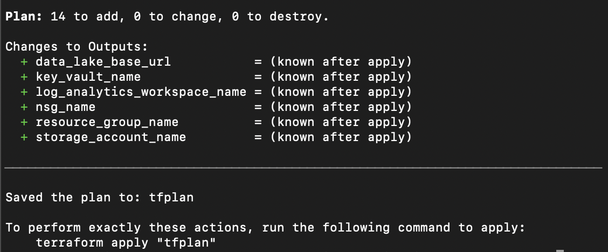
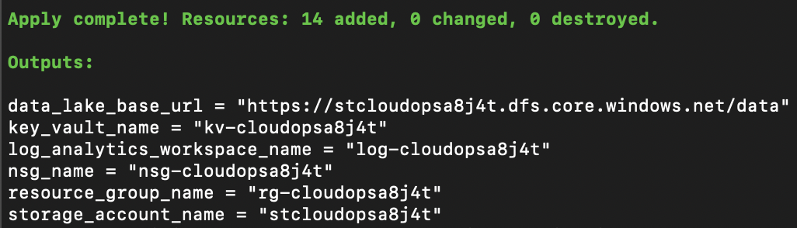
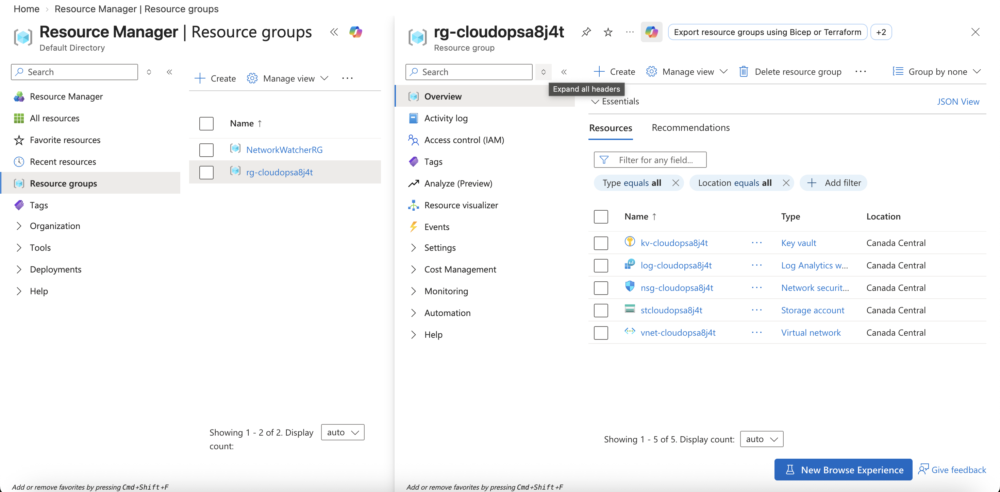

### Health check
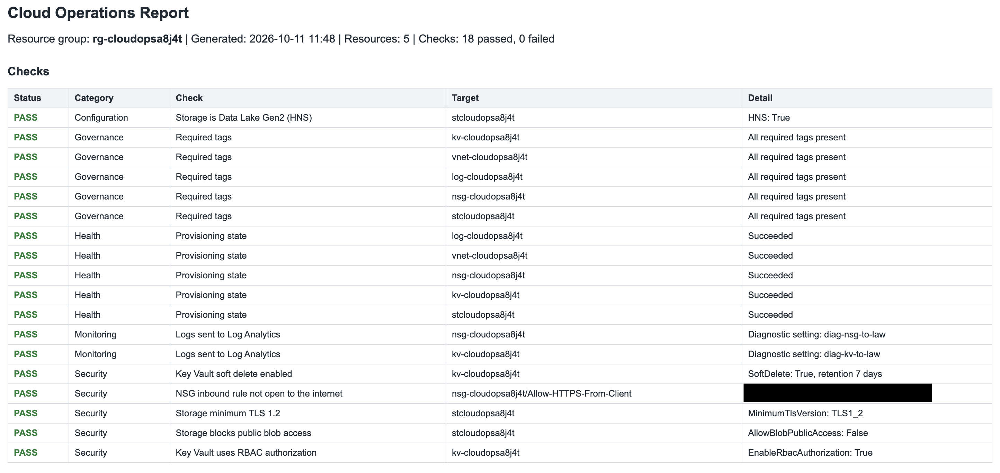
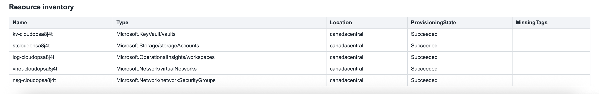

### Configuration drift: detect, identify, remediate, verify
1. **Detect** - a manual portal change opened RDP to the internet and removed a required tag. The health check reports FAIL:
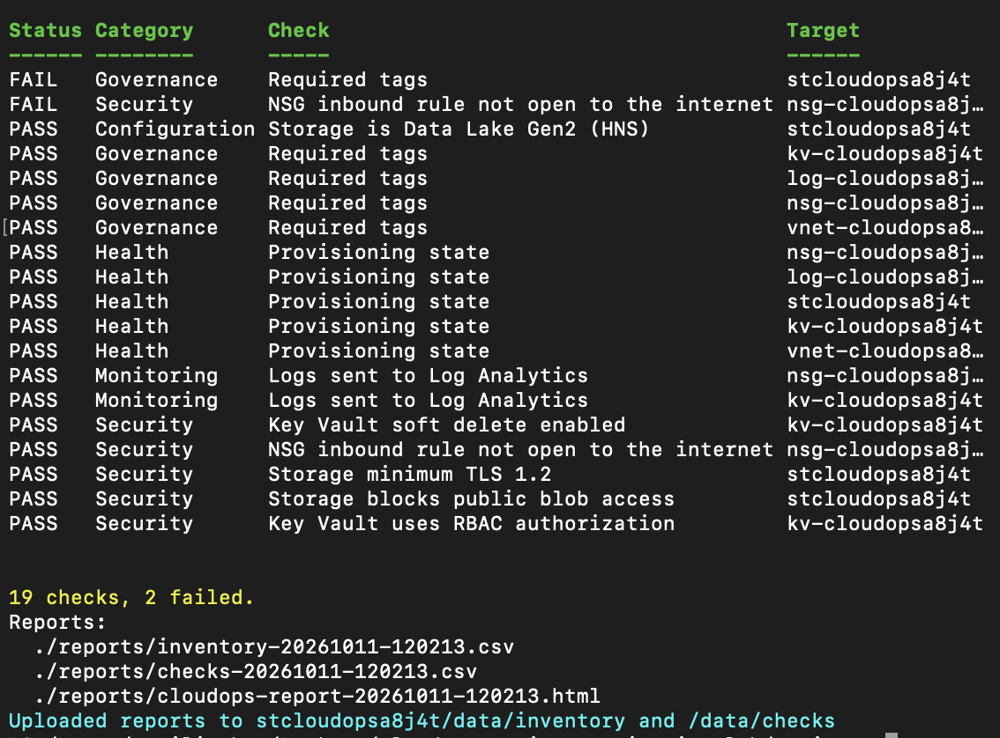
2. **Identify** - `terraform plan` shows exactly what drifted: the unauthorized NSG rule will be removed and the missing tag restored:
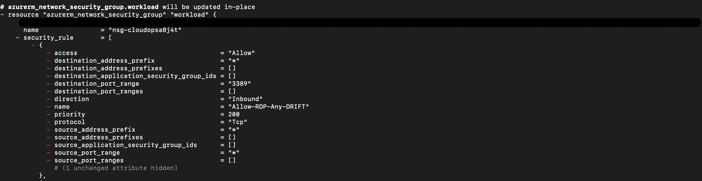
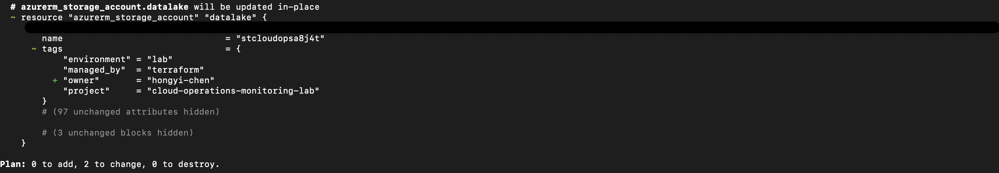
3. **Remediate** - `terraform apply` restores the standard configuration:
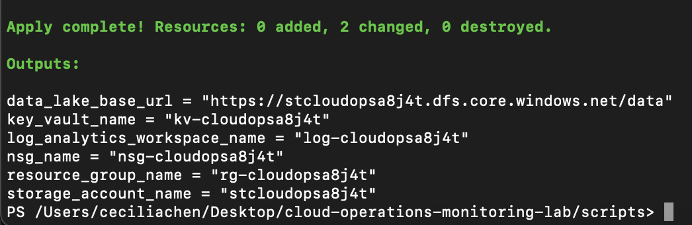
4. **Verify** - the health check passes again:
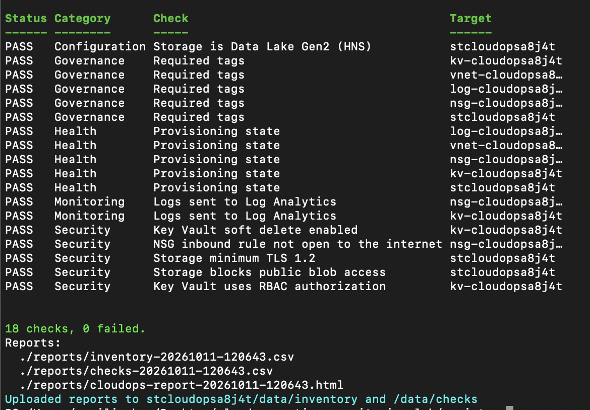

The Activity log shows who made the manual changes and when:
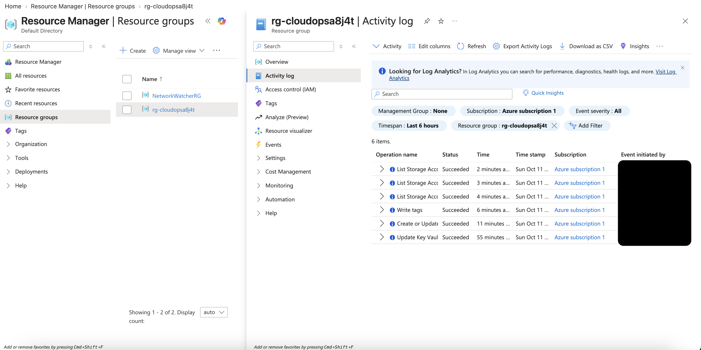

## Phase 1

```bash
az login
cd terraform
cp terraform.tfvars.example terraform.tfvars   # set subscription_id and client_ip
terraform init
terraform fmt -check
terraform validate
terraform plan -out tfplan
terraform apply tfplan
```

Health check:

```powershell
Connect-AzAccount
cd scripts
$rg = terraform "-chdir=../terraform" output -raw resource_group_name
./Get-CloudOpsReport.ps1 -ResourceGroupName $rg -UploadToDataLake
```

### Configuration drift test

1. In the portal, make the environment non-standard, for example:
   - NSG: add an inbound rule allowing port 3389 from **Any**
   - Storage account: remove the `owner` tag
2. Run the health check: the affected checks report **FAIL**.
3. `terraform plan` shows exactly what drifted; `terraform apply` restores the standard.
4. Run the health check again: everything is **PASS**.

## Phase 2 (in progress)

```bash
az provider register --namespace Microsoft.Synapse
# in terraform.tfvars: enable_synapse = true
terraform plan -out tfplan
terraform apply tfplan
```

Open `terraform output -raw synapse_studio_url` → **Develop → + → SQL script** → **Connect to: Built-in**, and run the queries in `sql/serverless_queries.sql` (replace `<storage_account_name>`).

## Clean up

```bash
terraform destroy
```

## Troubleshooting

| Symptom | Fix |
|---|---|
| `MissingSubscriptionRegistration` | `az provider register --namespace Microsoft.Synapse` (or the namespace in the error) and wait for `Registered`. |
| 403 when uploading reports or querying files | Role assignments take 5-10 minutes to apply. Wait and retry. |
| Synapse Studio blocks your IP | Your IP changed: update `client_ip`, then `terraform apply`. |
| No rows in Log Analytics | Wait up to 15 minutes; try both the resource-specific table and `AzureDiagnostics`. |
| Key Vault name already exists | A soft-deleted vault with that name exists: `az keyvault purge --name <name>`. |

All sample data is synthetic. `terraform.tfvars`, state files and generated reports are git-ignored.

### Issues I hit while building this

- **Az PowerShell sign-in failed on macOS** (`Interactive requests with mac broker enabled must be executed on the main thread`). Fixed with `Connect-AzAccount -DeviceCode`.
- **`terraform -chdir=...` rejected in PowerShell.** PowerShell splits the argument; quoting it (`"-chdir=../terraform"`) fixes it.
- **Provider deprecation warning** for `enable_rbac_authorization` on Key Vault. Updated to `rbac_authorization_enabled` ahead of azurerm v5.